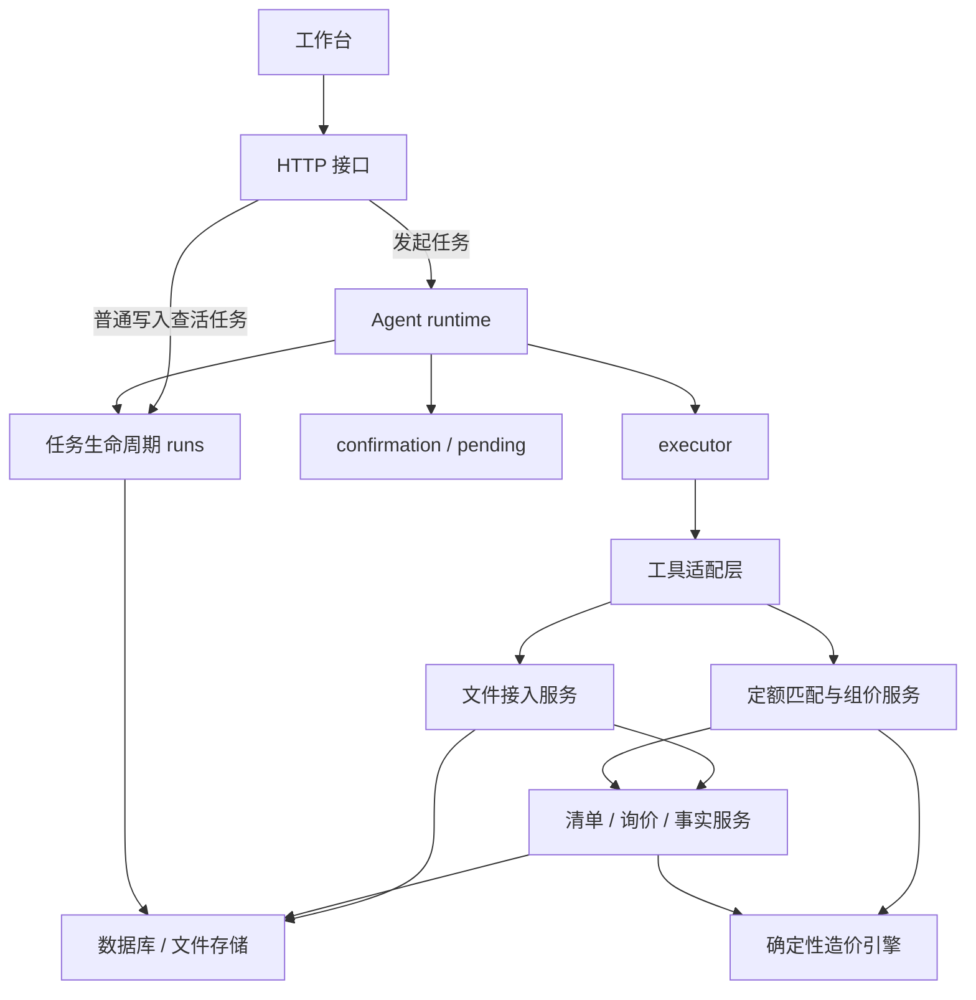

# 当前架构与核心流程重构

本项目继续采用一个 Next.js 进程、一个数据库和一套 Agent 引擎。此次重构解决实际调用链中的职责混合：普通写接口加载完整运行时，文件接入流程嵌在项目工具中，定额测算与写回维护两份相同业务流程。

## 模块职责

| 模块 | 职责 |
| --- | --- |
| src/app/api | HTTP 输入、状态码、响应；普通项目写入先查活任务 |
| agent/runtime.ts | 选择导入、规则或模型流程，执行步骤并结束会话 |
| agent/runs.ts | 启动清理、创建任务、活任务查询、终态持久化 |
| agent/confirmation.ts、pending.ts | 待确认状态、批准/取消、超时和 resolver 生命周期 |
| agent/executor.ts | 参数校验、ToolCall、回执关联、视图与事件输出 |
| agent/tools | 工具 schema、确认描述、将领域结果转为 observation/视图/回执文案 |
| file/ingest.ts | 文件归属、导入确认口径、按最新映射接入 Excel/PDF、模板与事实沉淀 |
| quota/matching.ts | 匹配、存疑候选、继承/借套/暂估/域外处置方向 |
| quota/pricing.ts | 清单/询价/偏好/费率读取；统一测算、写回和人工组价 |
| quota/spec.ts | 说明检索、章节核查方向、测算所需条文 |
| cost-engine | 确定性金额、工程量、语义、匹配、组价、取费计算 |
| database、file/storage.ts | 数据库连接/序列化和文件存储 |

领域服务返回业务数据，不依赖 Agent 的 ToolContext、ToolResult、工具注册或事件总线。项目文件导入通过可选进度回调传递说明文字。

costTools、materialTools、boqTools 和报告工具仍使用既有服务与计算引擎；本次集中调整文件接入、定额组价和任务生命周期，其他业务保持现有实现。

## 调用方向

普通清单编辑、设置更新、文件删除和回执撤销只依赖 runs，不再为查询活任务加载模型、规划器、工具注册与 Excel/PDF 工具。上传与重导需要发起任务，仍调用 runtime。

## 文件接入

1. file.inspect 调用 inspectProjectFile，先验证项目归属，再读取或缓存映射。
2. 导入确认描述来自 describeFileImport。模板冲突仍需确认，0 行预报仍提示用户。
3. 批准后 ingestProjectFile 重新读取当前映射。删除旧行、导入清单、导入询价使用同一事务。
4. 保留原有模板沉淀、合并写 meta、源文件事实抽取和 PDF 文本层处理。
5. fileTools 将导入结果转为会话观测、工作区视图和导入回执草稿。

## 定额组价

previewProjectPricing 与 applyProjectPricing 共用 calculateProjectPricing：

清单与询价 → 语义刷新 → 品牌/地区/期次偏好 → 主材与辅助材料取价 → 一次定额评分 → 章节条文 → cost-engine/calcQuota。

同一次写回中，管理费率和利润率各读取一次，校验与计算消费相同的值。缺费率拒绝写回，显式 0% 有效；缺材料价的不完整测算默认跳过；只落已确认的方案行。主材价继续作为组价输入，综合单价继续作为组价结果。

服务返回实际写入前后的快照，quotaTools 生成 Diff 和回执草稿，executor 持久化回执并关联视图。人工 replace/append/clear 同样由 pricing 服务完成业务操作。

## 任务生命周期

启动清理以 globalThis 上的共享 Promise 表示。并发首次请求都等待同一次清理结束，再进入查活任务和建单事务；清理失败不建单，下一次请求重试。

确认流程继续使用跨请求共享 resolver。确认事件或状态写入失败时立即清理 resolver 与定时器。无效工具参数直接交给 executor 报错，不创建确认卡。

成功、取消、失败均先持久化终态并清空 pendingAction，再发 run_finished，保证收到结束事件后读取项目不会仍显示任务执行中。

## 验证

依次运行 npm test、npm run typecheck、npm run test:real、npm run build、npm run test:e2e。

新回归覆盖启动清理并发、终态事件顺序、确认失败清理、跨项目文件隔离、批准后读取新映射、同事务导入、组价预览/写回一致、缺价跳过、显式零费率和目标项快照。

端到端脚本使用隔离 SQLite 和存储目录，运行生产构建后的真实 HTTP 接口，验证确认与 SSE、导入、设置、编辑、回执撤销、费用汇总、Excel 导出，以及实际组价写回与撤销。
